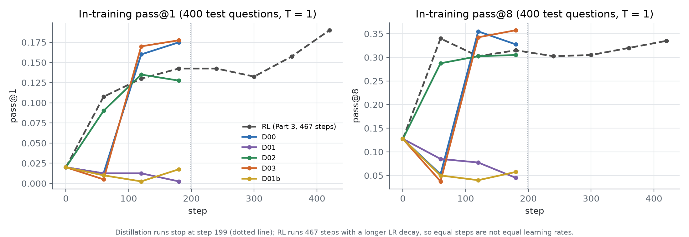
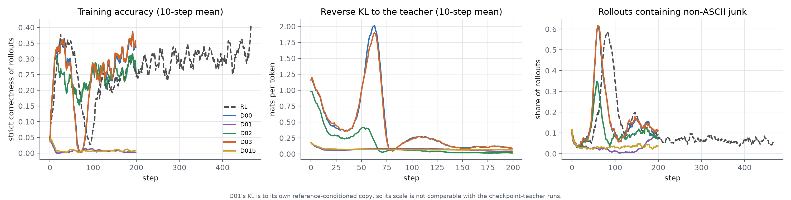
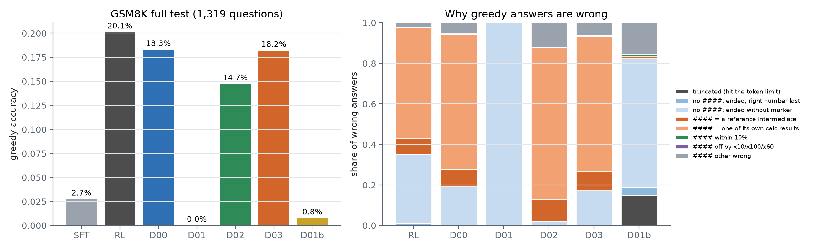

# Part 5: On-Policy Distillation

*This is the repository copy of the Part 5 section of our A4 report. Figures are regenerated by `analysis/compare_runs.py` and now include the exploratory run D01b; the report's figures were made before D01b finished.*

**Key findings:**

- On-policy distillation from our Part 3 RL model (D00) reached 18.27% on the GSM8K full test in 200 steps, against 20.09% for RL after 467 steps. The per-question difference is not significant (72 questions gained, 96 lost; McNemar p = 0.076), and D00 used 43% of RL's rollouts and half its training time.
- The student is bounded by its teacher. With a weaker teacher (RL step 120, 14.94%), the student reached 14.71%, three questions away from the teacher.
- Distillation did not prevent the collapse seen in Part 3. D00 and D03 both broke down between steps 50 and 70 (in-training pass@1 near 0, up to 72% of rollouts with non-ASCII junk) and recovered on their own. Adding the RL reward to the distillation term (D03) changed almost nothing.
- SDPO-style self-distillation with the reference solution in the teacher's prompt (D01) failed completely (0.0%): the student learned to answer every question with the teacher's instruction, "Correctly solve the original question." An exploratory rerun with the SDPO paper's setting for small models (D01b) also failed (0.76%).
- Distilled models give up less often than RL: 19% of D00's wrong answers end without an answer, against 34% for RL, but more of them compute the wrong quantity.

## 5.1: Method and Hypothesis

**Choice of method:** We use on-policy distillation as described by Thinking Machines Lab (2025). The student samples its own answers, a frozen teacher scores every sampled token, and the student is trained to lower the per-token reverse KL divergence KL(student ‖ teacher) on those samples. Compared with RL's single reward per answer, this gives a learning signal on every token, including on answers where all 16 samples in a group are wrong, which gave no gradient for half of the groups in Part 3. The teacher has to use the same tokenizer as the student, because the loss compares probabilities of the same tokens. Karpathy's released nanochat models use a different vocabulary from our 32,768-token tokenizer, so the strongest available teacher is our own Part 3 RL model (step 466, 20.09%). As an ablation we also test the self-distillation idea of SDPO (Hübotter et al., 2026), where the teacher is the student itself with extra information in its prompt.

**Implementation:** a4/part-5-distill/chat_distill.py is a copy of nanochat's scripts/chat_rl.py in which only the per-token advantage changes. For token y_t of a sampled answer, A_t = λ_r (r − mean r) + λ_d [log p_teacher(y_t) − log p_student(y_t)], with the teacher term under stop-gradient and a discount of 0, as in the Thinking Machines post. With λ_r = 0 and λ_d = 1 the gradient of chat_rl.py's token-level loss is the gradient of the reverse KL to the teacher. Sampling, data order, batch size, learning rates and the in-training pass@k evaluation are unchanged, so every run sees exactly the same first batch as the RL run: step 0 reproduces Part 3's pass@1 of 0.020, pass@8 of 0.128 and training reward of 0.039. The teacher is either a frozen checkpoint, scoring the same tokens with the same prompt, or a copy of the student whose prompt also contains the GSM8K reference solution (--teacher=self, with an optional EMA update). The Part 3 launcher and rollout logger gained a backward-compatible --script option, so the distillation runs reuse their logging, preemption resume and final evaluation. A CPU test with tiny models checks that a teacher identical to the student gives a KL of exactly 0 and that every teacher mode trains.

**Hypothesis (committed before any run):** We committed the hypothesis in a4/part-5-distill/HYPOTHESIS.md (https://github.com/UofT-CSC490-F2026/VocaLocate/commit/529fe48a7f4f17e47f584fc753ccce250b6ef4c0) before the first Part 5 GPU job, including smoke tests. In short: because distillation gives a signal on every token, we expected the student to recover most of the RL teacher's accuracy with fewer than half of RL's samples (200 steps instead of 467), to train more smoothly than RL, and to inherit the teacher's habits, including its mistakes. Reverse KL is mode-seeking and the teacher bounds what the student can learn, so we did not expect the student to exceed the teacher. Section 5.6 checks each prediction.

## 5.2: Experiment Configuration

**Starting checkpoint:** Every run starts from the Standard SFT model (d20-baseline-long after 932 SFT steps, 2.73% on GSM8K), the same starting point as Parts 3 and 4. Our team did not run midtraining, so this model is SFT-only.

**Shared settings:** 200 steps on 8×H100, one seed. Each step samples 16 answers for each of 16 training problems at temperature 1.0 and top-k 50, with at most 256 new tokens, and the learning rate decays linearly to zero over the 200 steps. The 200 steps cover the first 3,200 training problems, in the same order as RL.

**Evaluation:** The same protocol as Parts 3 and 4: in-training pass@1 and pass@8 on 400 test problems every 60 steps, and the stock chat_eval.py on the full test sets of all five chat tasks (greedy, up to 512 new tokens) on the final checkpoint. The final evaluations ran on 2 H100s so that they could run next to an 8-GPU training job. Re-evaluating the Part 3 RL model this way reproduced its scores exactly (GSM8K 20.09%, ARC-Easy 57.79, ARC-Challenge 46.42, MMLU 35.44, HumanEval 11.59, ChatCORE 0.2357).

**Table 5.1: Distillation runs (each ablation changes one thing relative to D00, except the exploratory D01b)**

| Run | Teacher | Advantage | W&B run |
|---|---|---|---|
| D00 | RL step 466, frozen | teacher log-ratio | https://forge.coreweave.com/wandb/riyadvaliyev/a4-distill/runs/n45228xx |
| D01 | the student itself (EMA rate 0.05) with the reference solution in its prompt | teacher log-ratio | https://forge.coreweave.com/wandb/riyadvaliyev/a4-distill/runs/sn9juxl1 |
| D02 | RL step 120, frozen (14.94% on GSM8K) | teacher log-ratio | https://forge.coreweave.com/wandb/riyadvaliyev/a4-distill/runs/vp2ap3xc |
| D03 | RL step 466, frozen | teacher log-ratio + (r − mean r) | https://forge.coreweave.com/wandb/riyadvaliyev/a4-distill/runs/zi7gzfrw |
| D01b (exploratory) | the student itself, frozen, with the reference solution | 0.9 (r − mean r) + 0.1 × teacher log-ratio | https://forge.coreweave.com/wandb/riyadvaliyev/a4-distill/runs/h3wpsbrp |

*Note: D01b was added after D01 collapsed and is not part of the pre-registered hypothesis. It tests the SDPO paper's own setting for small models (mostly RL reward, a little self-distillation, frozen teacher).*

## 5.3: Results of the Main Distillation Run (D00)

**Table 5.2: Full chat evaluation of every model (stock chat_eval.py, full test sets, greedy)**

| Model | Steps | GSM8K | ARC-E | ARC-C | MMLU | HumanEval | ChatCORE | GSM8K vs RL (gained / lost, p) |
|---|---|---|---|---|---|---|---|---|
| SFT (start) | 0 | 2.73% | 58.75 | 46.50 | 36.26 | 15.24 | 0.2133 | - |
| RL (Part 3) | 467 | 20.09% | 57.79 | 46.42 | 35.44 | 11.59 | 0.2357 | - |
| D00 | 200 | 18.27% | 54.92 | 45.31 | 34.72 | 10.37 | 0.2172 | 72 / 96, p = 0.076 |
| D01 | 200 | 0.00% | 57.66 | 46.93 | 35.58 | 0.00 | 0.1738 | 0 / 265, p < 0.001 |
| D02 | 200 | 14.71% | 55.13 | 44.28 | 35.07 | 7.32 | 0.2027 | 55 / 126, p < 0.001 |
| D03 | 200 | 18.20% | 54.76 | 45.31 | 34.75 | 10.37 | 0.2166 | 64 / 89, p = 0.052 |
| D01b (exploratory) | 200 | 0.76% | 59.09 | 46.93 | 35.80 | 12.20 | 0.2041 | 8 / 263, p < 0.001 |

*Note: "Gained / lost" counts the test problems the run answers correctly and RL does not, and the reverse; p is the exact McNemar test on those counts. RL step 120, D02's teacher, scores 14.94% on GSM8K.*

**Figure 5.1: In-training pass@1 and pass@8 against step for RL and the distillation runs.**

*Note: 400 test problems, 8 samples each at temperature 1.0. The distillation runs end at step 199; RL's learning rate decays over 467 steps, so equal steps do not mean equal learning rates.*

**Figure 5.2: Training accuracy, reverse KL to the teacher and share of rollouts with non-ASCII junk, 10-step means.**

*Note: D01's KL is measured against its own reference-conditioned copy, so its scale is not comparable with the runs that use a checkpoint teacher. D00 and D03 overlap almost everywhere.*

**Accuracy:** D00 reached 18.27% (241 of 1,319), 91% of RL's 20.09% (265). It fixed 222 problems that the SFT model got wrong and broke 17, while RL fixed 246 and broke 17. Against RL directly, 169 problems are right for both, 72 only for D00 and 96 only for RL, a difference that is not significant (p = 0.076). Accuracy by solution length follows RL's pattern: 35.9% on 2-step problems (RL 39.8%), 9.0% on 4-step problems (RL 11.4%) and 1.1% on problems with 6 or more steps (RL 2.3%).

**Cost:** D00 used 51,200 rollouts against RL's 119,552 (43%), and its 200 steps took 33 minutes on 8×H100 including startup and four in-training evaluations, against 69 minutes for RL's 467 steps. Scoring with the teacher is one forward pass without gradients, so a distillation step costs about the same as an RL step; the saving comes from needing fewer steps.

**Training dynamics:** The KL to the teacher fell from 1.16 to 0.35 nats per token in the first 20 steps while training accuracy rose to 0.40 by step 10, faster than RL. Between steps 45 and 70 the run collapsed: the KL rose to 2.4, the share of rollouts writing #### fell from 98% to 0, up to 72% of rollouts contained non-ASCII text, and in-training pass@1 at step 60 dropped to 0.013, below the SFT start. The run recovered without intervention. By step 120 it reached pass@1 0.160 and pass@8 0.355, above RL's best pass@8 (0.340), and it ended with a KL of about 0.09.

**Why the collapse happened:** The collapse is not caused by the RL reward, since D00 has none, and it is not caused by the objective itself: while the student was being trained toward the teacher, it moved away from it, with the KL rising from 0.47 to 2.4. This points to the optimization rather than the loss. chat_rl.py has no clipping or trust region, and its learning rate is highest in the first steps; over 200 steps the schedule also decays faster than in RL, so steps 45 to 70 still use 65 to 78% of the peak rate. The same window produced Part 3's collapse (steps 60 to 100). D02, whose teacher is closer to the student, had a milder version (up to 35% junk), and D01, whose signal was weak, had none. Testing this directly would need a rerun with a lower learning rate or gradient clipping, which we did not do.

## 5.4: Ablations

**D02, a weaker teacher:** With RL step 120 as the teacher, the student tracked the teacher closely. Its KL fell to 0.015 nats per token, its in-training pass@1 and pass@8 at step 120 were 0.135 and 0.303 (the teacher's own values at its step 120 were 0.130 and 0.303), and its final GSM8K score was 14.71% against the teacher's 14.94%. The other tasks moved with the teacher too (HumanEval 7.3 vs 6.7). D00 beats D02 by 3.6 points (118 problems only D00, 71 only D02, p < 0.001), so a better teacher gives a better student. D02 also almost never gives up: it writes #### on 98% of test answers, and only 2% of its wrong answers end without one. The step-120 teacher was saved before RL learned to stop early.

**D01, SDPO-style self-teacher:** This run failed completely: 0.0% on GSM8K and 0.0% on HumanEval, while the multiple-choice scores, which only compare answer probabilities, stayed at the SFT level (ARC-Easy 57.7, MMLU 35.6). On 1,248 of the 1,319 test problems the greedy answer is exactly the last line of the teacher's prompt, "Correctly solve the original question.", and most of the rest read "The correct solution to the original question is (indeed) correct." The self-teacher sees phrases such as "Correct solution:" in its prompt, and a small model readily repeats text from its context, so it gives those phrases high probability. Reverse KL then pulls the student toward producing them, although the student never sees that prompt: the teacher's privileged context leaks into the student. The EMA teacher follows the student and reinforces the habit, and without a reward term nothing pushes back. The signal was weak from the start: the step-0 KL to the self-teacher was 0.18 nats per token, against 1.16 for the RL teacher. This matches the SDPO paper's caveat that the method depends on in-context learning and falls behind GRPO below about 1.5B parameters. The paper also never puts ground-truth solutions in the teacher's prompt; it uses the model's own successful answers, which our 3% model rarely produces.

**D03, distillation plus the RL reward:** Adding (r − mean r) changed almost nothing. D03's curves follow D00's within a few hundredths at every logged step, including the collapse, and its final score is 18.20% against D00's 18.27% (45 problems only D00, 44 only D03, p = 1.0). The per-token log-ratios are much larger than the reward advantage, which is at most ±1 per answer and is averaged over its tokens, so the distillation term dominates the update. A smaller distillation weight would be needed for the reward to matter.

**D01b (exploratory):** After D01 collapsed we ran the SDPO paper's own setting for small models: a frozen self-teacher with the reference solution in its prompt, and the advantage 0.9 (r − mean r) + 0.1 × the teacher log-ratio. It also failed, in a different way: 0.76% on GSM8K (10 of 1,319), below the SFT start. Its answers are readable step-by-step solutions with correct calculator use, but only 18% of test answers end with a #### answer (SFT: 40%); 63% of its wrong answers stop without one and 15% reach the 512-token limit. The reward rarely had anything to say: training accuracy averaged 0.8%, and only 9% of the 16-answer groups had a single correct answer, so for the other 91% the reward term was exactly zero and the self-distillation term, present on every token, set the direction of the update. Its other abilities stayed at the SFT level (ARC-Easy 59.1, MMLU 35.8, HumanEval 12.2, the best HumanEval of any run), consistent with a frozen teacher that keeps the student close to the starting model. With a starting model this weak, self-distillation did not lead to the answer format that RL learns within 30 steps.

## 5.5: Distillation Compared with RL

**Figure 5.3: Full-test GSM8K accuracy and the reasons greedy answers are wrong, for RL and the distillation runs.**

*Note: Error categories are Part 3's rules, applied to every model's greedy answers on all 1,319 test problems.*

**Accuracy and sample efficiency:** RL remains the most accurate model, but the best distillation run comes within 1.8 points with 43% of the rollouts and half the wall-clock time, and the gap is not significant on 1,319 problems. Distillation also peaked higher on the in-training pass@8 (0.355 vs 0.340), which samples 8 answers per problem at temperature 1.0. This supports the Thinking Machines claim that a dense per-token signal needs far fewer samples than RL, with the caveat that our teacher was itself produced by RL: the RL run's cost is part of the cost of distillation here.

**Types of mistakes:** Distillation changed how the model fails more than how often. RL's model writes #### on 72% of test answers, and 34% of its wrong answers end without an answer, often in the middle of a sentence. D00 writes #### on 84%, and only 19% of its wrong answers end without one; D02 writes it on 98% (2%). Instead, more wrong answers report one of the model's own intermediate results: 67% for D00 and 75% for D02, against 55% for RL. The distilled models attempt more problems to the end but still pick the wrong quantity, the main error type found in Part 3.

**Other tasks:** D00 lost more on the other tasks than RL did, relative to the SFT start: ARC-Easy −3.8 points (RL −1.0), MMLU −1.5 (RL −0.8) and HumanEval −4.9 (RL −3.7). The collapse may have caused part of this, since both runs that collapsed (D00 and D03) show the same losses, while D01, whose generation failed but which never collapsed into junk text, kept its multiple-choice scores.

## 5.6: Hypothesis Check

**Table 5.3: Pre-registered predictions and outcomes**

| Prediction | Outcome | Result |
|---|---|---|
| D00 reaches at least 17% on GSM8K | 18.27% | Met |
| D00 does not exceed the teacher by more than 1 point | 18.27% vs 20.09% | Met |
| D00's pass@1 at step 60 is at least RL's 0.108 | 0.013 (collapse) | Not met |
| No collapse: non-ASCII share below 10% at every step; KL falls by at least half | Non-ASCII peaked at 72%; KL fell from 0.89 to 0.09 (first and last 10 steps) | Partly met |
| D00's mistakes within 10 points of RL's (34% ending without ####, 55% own intermediate result) | 19% and 67% | Not met |
| D00 loses no more than RL on ARC, MMLU and HumanEval | Larger losses on all four | Not met |
| D01 is clearly worse than D00 and RL (at most 10%) | 0.0% | Met |
| D02 is below D00 and tracks its weaker teacher | 14.71% vs teacher 14.94% and D00 18.27% | Met |
| D03 is at least D00 + 1 point | 18.20% vs 18.27% | Not met |

*Note: The SFT model already has non-ASCII characters in 12% of its rollouts at step 0, so the 10% threshold in prediction 4 could not have been met even without a collapse.*

The central claim held: distillation from the RL model recovered most of its accuracy with fewer than half of the samples, and the student was bounded by its teacher. The predictions about stability and about inheriting the teacher's behaviour did not hold. Distillation inherited the training instability of chat_rl.py's optimization rather than avoiding it, and the student made fewer early stops but more wrong-quantity errors than the teacher.

## 5.7: Reproducibility

Code, results and the hypothesis are on the a4/distillation branch (https://github.com/UofT-CSC490-F2026/VocaLocate/tree/a4/distillation) in a4/part-5-distill: chat_distill.py (trainer), local_smoke_test.py (CPU test), analysis/compare_runs.py (tables and figures), results/ (p5_summary.csv, p5_per_step.csv, p5_fulltest.csv with every model's correctness on each test problem) and README.md with the launch commands. The runs are logged in the W&B project riyadvaliyev/a4-distill (links in Table 5.1). Checkpoints, rollouts and evaluation outputs are on Modal volume vocalocate-a4-p5.

**Works Cited (Part 5)**

Hübotter, J., et al. (2026). Reinforcement Learning via Self-Distillation (SDPO). arXiv:2601.20802. https://arxiv.org/abs/2601.20802

Karpathy, A. (2025). nanochat. https://github.com/karpathy/nanochat

Thinking Machines Lab (2025). On-Policy Distillation. https://thinkingmachines.ai/blog/on-policy-distillation

