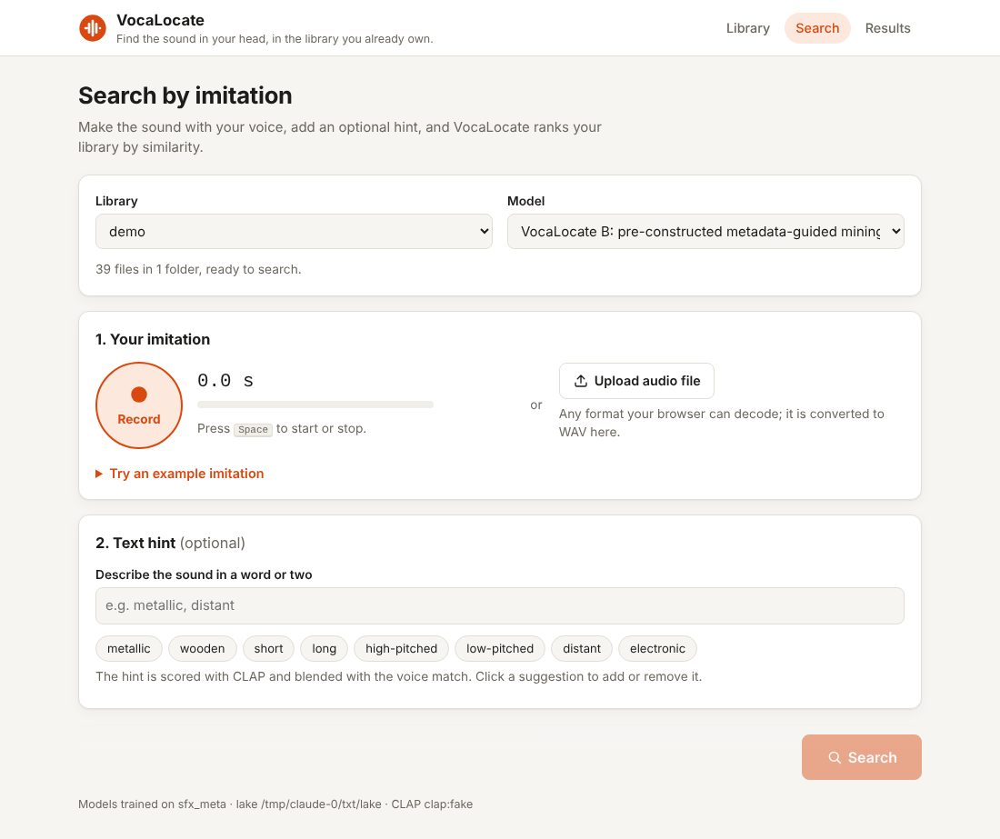
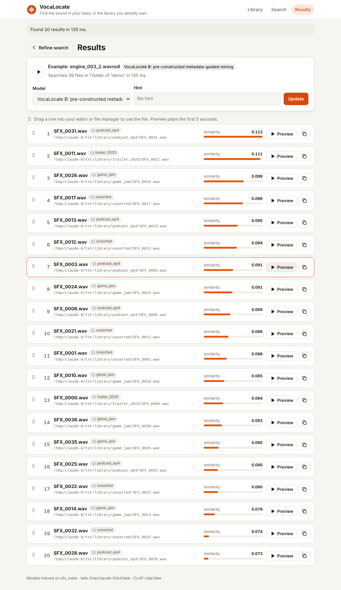

# VocaLocate demos: semi-hard negative mining

Two working versions of VocaLocate from the "Semi-Hard Negative Mining Approach"
table in *Project Feature - List to Confirm*, built on top of the A2 data
pipeline in [`../pipeline`](../pipeline):

| | **A. Retrieval-driven mining** | **B. Pre-constructed metadata-guided mining** |
| --- | --- | --- |
| Idea | Learn from the real retrieval mistakes the baseline makes | Teach fine distinctions between SFX that metadata says are related, even if they are not current mistakes |
| Negative | A non-target real SFX the baseline already ranks highly (top-K) | A non-target real SFX from a pool built from category / tags before fine-tuning |
| False-negative guard | Drop other takes of the target's recording (metadata) and audio near-duplicates (top 1% SFX-SFX similarity); never take candidates scored above the positive | Other takes of the target's recording are never in the pool; same near-duplicate filter |
| Semi-hard rule | Keep `s_pos − band < s_neg < s_pos`, sample from the band (not just the top wrong result) | Same band on the metadata pool, filled tier by tier: same category + tags → same category → shared tags |
| Training example | same imitation + correct SFX + semi-hard negative SFX | same |
| Code | `mining.py` (`strategy="retrieval"`) | `mining.py` (`strategy="metadata"`) |

Both start from the same QVIM baseline and are fine-tuned the same way
(contrastive + triplet loss). A third fine-tune with **random** real-SFX
negatives is the control from stage 5 of the technical flow: it shows whether
mining helps beyond simply training for longer. Metadata is only read at
training time. Searching a user's library never needs it.

## Models

| Part | Default | Option | Notes |
| --- | --- | --- | --- |
| Voice encoders (imitation + SFX) | small CNN from scratch (`--encoder cnn`) | **`--encoder mobilenetv3`**: EfficientAT `mn10_as`, AudioSet-pretrained | The QVIM challenge baseline's encoder. Both towers start from the same weights and the 960-value pooled features are the embedding. The model code is vendored in `efficientat/` (MIT); weights download to `~/.cache/efficientat` on first use. The CNN stays as the default so tests and CPU demos need no download. |
| Text branch | off | **`--text-branch`**: frozen CLAP, `laion/clap-htsat-unfused` via Hugging Face `transformers` | Stage 6-7: hints such as "metallic short" are scored against every SFX's CLAP audio embedding and fused with the voice score, `α·z(voice) + (1 − α)·z(text)`, with α tuned on validation. We use LAION CLAP instead of Microsoft's msclap (cited in A1) because msclap pins `numpy<2` and needs a CUDA-matched torchaudio, which break the pipeline's pyarrow. LAION-Audio-630K includes AudioCaps, Clotho, Freesound and BBC Sound Effects, so text scores on those sets will look optimistic (A2 Part Two). |

`vocalocate-demo fetch-models` downloads both sets of weights and prints a quick check.

## How it follows the A2 pipeline

```
synthetic SFX + imitations ──► pipeline dataset flow (sfx_meta ingester)
   (A2 "data we can generate")     bronze raw_files → silver clips, pairs, sfx_metadata
                                   → gold log-mel features, grouped splits → DuckDB
                                                       │
            v_training_pairs, v_sfx_candidates ◄───────┘
                     │
   1. baseline dual encoder (contrastive)                         train split
   2-3. mine negatives: retrieval / metadata / random  ──► gold hard_negatives table,
                                                           pipeline_runs (flow "mining")
   4. fine-tune one model per strategy                            train split
   5. keep each model's best epoch by validation MRR              val split only
   8. score the frozen models once                                test split
                     │
   messy library (held-out SFX renamed SFX_0001.wav in project folders)
          ──► pipeline library flow (incremental) ──► gold embeddings table (cached per model)
          ──► search with a held-out imitation
```

What was added to the pipeline for this (all covered by its tests):

* `ingest/sfx_meta.py`: an ingester for any SFX dataset with a metadata CSV
  (`file, role, sound_id, imitates, category, tags, recording_id, ...`). Clips
  cut from one recording share a group key, so they never straddle splits.
* New tables: `sfx_metadata` (silver, the SFX_Metadata wish-list schema),
  `embeddings` and `hard_negatives` (gold; the "mined hard negatives" dataset
  from A2 Part Two, the relevance schema with a model score instead of a rating).
* New views: `v_sfx_candidates` (every clean reference/library SFX with split
  and metadata) and `v_hard_negatives` (mined negatives joined with metadata);
  `v_training_pairs` now carries the feature paths.

## The app

```bash
vocalocate-demo app --workdir demo_out            # after `vocalocate-demo run`; opens on http://127.0.0.1:8765
vocalocate-demo app --workdir demo_mn_491 --text  # MobileNetV3 run with CLAP text hints
vocalocate-demo app --lake demo_out/lake --root ~/SFX --name mine --text
```

A local web UI over the same pipeline and models, following the product flow:

1. **Library**: add folders (paths on this machine, nothing is uploaded). They are indexed by the A2
   library flow (incremental: unchanged files are skipped, moved files are recognised) and embedded
   once per model. Progress shows each folder, its file count and the current step.
2. **Search**: record an imitation in the browser (or upload a file, or pick one of the demo's held-out
   example imitations), add an optional text hint, and pick VocaLocate B, A or the baseline.
3. **Results** (a separate page): file name, project folder, path, similarity, a 5-second preview,
   copy path and drag-and-drop into an editor. Changing the hint reruns the search with the
   cached query embedding and library index; changing the model embeds the query once with that
   model (the library's embeddings for every model are cached at indexing time).

A 68-second walkthrough is in [`docs/app_walkthrough.mp4`](docs/app_walkthrough.mp4) (demo CNN model,
synthetic library, Chromium's fake microphone).

| Search | Results |
| --- | --- |
|  |  |

The server is standard-library Python (`app.py`) and binds to localhost only. It serves only
files that are in a library index.

## Real data: Vocal Imitation Set, QVIM DEV and CAPTDURE

The synthetic set is too small and too unlike real audio to settle the mining question (see Results).
The same pipeline and commands run on real data:

* **Training and evaluation: the [Vocal Imitation Set](https://github.com/interactiveaudiolab/VocalImitationSet)**
  (`ingest-dataset --source vis`). It has 302 AudioSet classes, one imitated Freesound reference per
  class, and about 2,700 other recordings of the same classes (`non_reference`, the fine-grained
  distractors the dataset was built for). There are 5,601 accepted imitations. Mining metadata
  comes straight from the dataset:
  * category = AudioSet class, tags = its ontology path (depth 1-6),
  * recording = Freesound ID;
  * each imitator's own written description of the sound is the text hint for CLAP.
* **External benchmark: the QVIM challenge DEV set** (`ingest-dataset --source qvim_dev`,
  `vocalocate-demo benchmark --source vis --on qvim_dev`). The models never train or tune on it.
  The table prints next to the published MRRs: random 0.044, the challenge's MobileNetV3
  baseline 0.273, the winner 0.293. Those models trained on all of VimSketch, which is larger than
  the Vocal Imitation Set and contains it, so they are a reference point, not an equal comparison.
* **Text-branch benchmark: [CAPTDURE](https://zenodo.org/records/7965763)** (`ingest-dataset --source
  captdure`, `vocalocate-demo benchmark-text --on captdure`). 1,044 single-source household sounds
  the authors recorded themselves (14 classes), with 4,902 crowd-written captions. Each English
  caption ranks every clip with frozen CLAP. The audio is not from Freesound or AudioSet and the set
  postdates the CLAP models, so CLAP has not seen it (A2 Part Two reserves it for this test).

```bash
vocalocate-pipeline --config demo/configs/demo.toml --lake runs_real/lake --workers 6 \
    ingest-dataset --source vis --path ~/data/VocalImitationSet
vocalocate-pipeline --config demo/configs/demo.toml --lake runs_real/lake ingest-dataset --source qvim_dev --path ~/data/qvim-dev
vocalocate-demo --lake runs_real/lake -v train --source vis --encoder mobilenetv3 --text-branch \
    --device cuda --frames 1000 --batch-size 16 --epochs 20 --ft-epochs 5 --seed 490
vocalocate-demo --lake runs_real/lake benchmark --source vis --on qvim_dev
vocalocate-pipeline --config demo/configs/demo.toml --lake runs_real/lake ingest-dataset --source captdure --path ~/data/captdure
vocalocate-demo --lake runs_real/lake benchmark-text --on captdure --device cuda
vocalocate-demo app --lake runs_real/lake --source vis --root ~/SFX --text   # search your own library with these models
```

### Real-data results (MobileNetV3 + CLAP, 3 seeds: 490, 491, 492)

Trained on the Vocal Imitation Set train split (3,317 pairs), 20 baseline epochs and 5 fine-tuning
epochs per strategy, 1,000 frames, batch 16, on an 8 GB GPU (about 35 minutes per seed including
the QVIM DEV benchmark). Mining settings were picked on validation; every seed kept band 0.25 and
near-duplicate quantile 0.99.

**Vocal Imitation Set test split** (1,158 imitations), mean ± std over 3 seeds:

| model | R@1 | R@5 | MRR | fine MRR | nDCG@10 | Δ MRR vs baseline |
| --- | ---: | ---: | ---: | ---: | ---: | ---: |
| QVIM baseline (no mining) | 0.170 ± 0.009 | 0.438 ± 0.005 | 0.295 ± 0.006 | 0.853 ± 0.010 | 0.323 ± 0.004 | – |
| Control: random negatives | 0.168 ± 0.011 | 0.432 ± 0.007 | 0.293 ± 0.009 | 0.851 ± 0.008 | 0.320 ± 0.007 | −0.003 (0/3 seeds better) |
| A: retrieval-driven mining | 0.168 ± 0.010 | 0.436 ± 0.006 | 0.295 ± 0.006 | 0.855 ± 0.008 | 0.324 ± 0.003 | −0.001 (0/3 seeds better) |
| B: metadata-guided mining | 0.165 ± 0.012 | 0.428 ± 0.012 | 0.291 ± 0.010 | 0.852 ± 0.010 | 0.320 ± 0.007 | −0.005 (0/3 seeds better) |

**QVIM DEV** (969 imitations, never trained or tuned on), MRR per seed:

| model | seed 490 | seed 491 | seed 492 |
| --- | ---: | ---: | ---: |
| QVIM baseline (no mining) | 0.266 | 0.263 | 0.269 |
| Control: random negatives | 0.266 | 0.263 | 0.267 |
| A: retrieval-driven mining | 0.267 | 0.263 | 0.270 |
| B: metadata-guided mining | 0.270 | 0.263 | 0.268 |
| published: random ranking | 0.044 | | |
| published: QVIM challenge MobileNetV3 baseline (trained on VimSketch) | 0.273 | | |
| published: challenge winner | 0.293 | | |

**Text branch on the Vocal Imitation Set** (test imitations with the imitator's description, α tuned
on validation, mean of 3 seeds): voice only 0.295, text only 0.286, voice + text **0.483** for the
baseline (+0.187, better on 3/3 seeds; the other models gain +0.185 to +0.189), α = 0.6 every time.

**CAPTDURE text-to-audio** (frozen `laion/clap-htsat-unfused`, 4,902 captions × 1,044 clips):

| | MRR | R@1 | R@5 | R@10 | fine MRR | nDCG@10 | class R@1 |
| --- | ---: | ---: | ---: | ---: | ---: | ---: | ---: |
| CLAP (frozen) | 0.052 | 0.013 | 0.061 | 0.112 | 0.097 | 0.195 | 0.454 |
| random ranking | 0.007 | 0.001 | | 0.010 | | | ≈ 0.07 |

How to read the real-data results:

* **Mining does not help here.** No strategy beat the baseline on the test split in any seed; the
  differences are within one standard deviation. Fine-tuning rarely improved validation MRR (most
  strategies kept epoch 0, the baseline weights), so model selection mostly returned the baseline.
* **The baseline is competitive.** 0.263–0.270 on QVIM DEV against the published 0.273, trained on
  the Vocal Imitation Set alone, a subset of VimSketch.
* **Text hints add a lot on this set (+0.19 MRR), but treat that number with care.** The Vocal
  Imitation Set's reference sounds come from Freesound, which is part of CLAP's training data.
  On CAPTDURE, which CLAP has not seen, CLAP picks the right *kind* of sound first 45% of the time
  (vs ~7% by chance) but rarely the exact take (MRR 0.052): each class has many near-identical
  recordings and captions that fit all of them. So a text hint narrows the class; the voice has to
  pick the take. The two benchmarks measure different things, so CAPTDURE does not show that the
  Vocal Imitation Set number is inflated, only that it should not be read as clip-level text search.
* **Leakage checks.** `mn10_as` is pretrained on AudioSet only (YouTube audio, no imitations), so
  the Vocal Imitation Set test split is clean for the voice model. The published QVIM models trained
  on VimSketch, which contains the Vocal Imitation Set, so we compare with them only on QVIM DEV. If
  the team later trains the encoders on VimSketch, the Vocal Imitation Set can no longer be a test set.

## The QVIM 2025 winning recipe on our data

The winning challenge entry ([Bhattacharjee et al., arXiv 2608.19174](https://arxiv.org/abs/2608.19174),
Submission #2) trains one shared MobileNetV3 with a contrastive loss plus a semi-hard triplet loss
from the first epoch, with augmentation on both branches. Its negatives are extra imitations that
never form pairs. `vocalocate-demo recipe` replicates that recipe on our data and changes only the
negative source between runs, so A, B and their method are compared on equal terms
(`recipe.py` documents every choice the paper leaves open):

| run | encoder | augmentation | triplet negatives |
| --- | --- | --- | --- |
| `greif` | two towers | yes | none (the Greif et al. / QVIM baseline recipe) |
| `shared` | shared | yes | none (the reference for Δ) |
| `excluded` | shared | yes | **C**: rejected/practice imitations of related sounds (their method) |
| `excluded_noaug` | shared | no | C, to separate augmentation from mining |
| `retrieval` | shared | yes | **A**: the current model's top wrong SFX, re-mined every 5 epochs |
| `metadata` | shared | yes | **B**: metadata-related SFX |
| `random` | shared | yes | random SFX (control) |

The Vocal Imitation Set's 5,260 excluded imitations (drafts, practice takes, rejected takes) are
ingested as `unpaired_imitation` clips: they share their target's split but never form a pair.
Each class there has one reference, so "related" means a *different* sound that shares the
category or ontology tags, never the anchor's own sound.

```bash
vocalocate-demo --lake runs_real/lake -v recipe --source vis --encoder mobilenetv3 --device cuda \
    --frames 1000 --batch-size 16 --seed 490          # one seed, all seven runs; re-run to resume
vocalocate-demo --lake runs_real/lake benchmark-onnx --model model_v1.onnx --on qvim_dev  # the winner's released model
vocalocate-demo summarize runs_real/lake/models/vis/recipe-490 runs_real/lake/models/vis/recipe-491 ...
```

On an 8 GB GPU the recipe fits only batch 16 (the paper uses 64) at about 3 minutes an epoch, so
one seed of seven runs takes about 11 hours. `modal/recipe_app.py` instead runs every
(seed, recipe) training in its own Modal GPU container, in parallel, at batch 64. It first copies
the warehouse and features from the S3 lake that the AWS pipeline fills (`infra/`), and at the end
publishes the models to the S3 models bucket, through an AWS role it assumes with its Modal OIDC
token. See its docstring for the one-time setup, or `--no-sync` to use a hand-uploaded volume:

```bash
pip install modal && modal setup
terraform -chdir=infra/envs/prod output -raw modal_secret_command | sh       # once: AWS role + buckets
modal run demo/modal/recipe_app.py --seeds 9999 --models excluded --epochs 1   # probe one epoch
modal run --detach demo/modal/recipe_app.py                                   # 3 seeds x 7 recipes
aws s3 sync s3://<models bucket>/vis ./runs_modal/vis
```

### Recipe results (3 seeds: 490, 491, 492)

Trained on the Vocal Imitation Set train split, 30 epochs, batch 64, on Modal L40S GPUs (all 21
trainings in parallel: about 21 minutes of wall time, 4–9 minutes of training each). The kept
epoch was chosen on validation, and it was a real epoch (8–24) in every run.

**Vocal Imitation Set test split** (1,158 imitations) and **QVIM DEV** (969), mean ± std over 3 seeds:

| run | R@1 | R@5 | MRR | nDCG@10 | Δ MRR vs `shared` | QVIM DEV MRR |
| --- | ---: | ---: | ---: | ---: | ---: | ---: |
| `greif`: two towers + augmentation | 0.176 ± 0.006 | 0.425 ± 0.006 | 0.296 ± 0.006 | 0.323 ± 0.003 | −0.008 (0/3 seeds better) | 0.266 ± 0.002 |
| **`shared`: shared encoder + augmentation** | 0.194 ± 0.005 | 0.419 ± 0.006 | **0.304 ± 0.004** | 0.326 ± 0.004 | – | **0.275 ± 0.001** |
| `excluded` (C): their excluded-imitation negatives | 0.188 ± 0.004 | 0.422 ± 0.011 | 0.302 ± 0.005 | 0.327 ± 0.005 | −0.003 (0/3 seeds better) | 0.267 ± 0.007 |
| `excluded_noaug`: C without augmentation | 0.182 ± 0.006 | 0.402 ± 0.006 | 0.287 ± 0.007 | 0.301 ± 0.007 | −0.017 (0/3 seeds better) | 0.264 ± 0.002 |
| `retrieval` (A): re-mined top wrong SFX | 0.191 ± 0.007 | 0.419 ± 0.002 | 0.302 ± 0.005 | 0.324 ± 0.004 | −0.002 (1/3 seeds better) | 0.268 ± 0.004 |
| `metadata` (B): metadata-related SFX | 0.182 ± 0.004 | 0.408 ± 0.006 | 0.291 ± 0.003 | 0.314 ± 0.001 | −0.014 (0/3 seeds better) | 0.262 ± 0.005 |
| `random`: control | 0.184 ± 0.006 | 0.394 ± 0.002 | 0.288 ± 0.003 | 0.310 ± 0.004 | −0.016 (0/3 seeds better) | 0.264 ± 0.001 |
| the winner's released model (`model_v1.onnx`, our pipeline, 32 kHz) | | | | | | 0.272 |
| published: QVIM baseline / challenge winner | | | | | | 0.273 / 0.293 |

The share of anchors with an active semi-hard triplet falls during training for C (0.88 → 0.63),
B (0.88 → 0.79) and random (0.93 → 0.57), but rises for A (0.54 → 0.97): re-mining keeps finding
negatives that still break the margin as the model improves.

How to read the recipe results:

* **The recipe is better than our earlier setup, and the gain comes from the shared encoder and
  augmentation, not the triplet term.** `shared` is the best run on both test sets: 0.304 test MRR
  against 0.295 for the earlier baseline, and 0.275 on QVIM DEV against 0.263–0.270. That matches
  the winners' released model on the same pipeline (0.272) and the published QVIM baseline (0.273),
  trained on the Vocal Imitation Set alone. The gap to the published 0.293 remains.
* **No negative source beats contrastive training alone.** Their method (C), A and B all fall
  slightly below `shared` on test and on QVIM DEV. A and C are within one standard deviation of it;
  B and the random control are clearly below it. This repeats what we found on our earlier setup,
  now under the winners' own recipe.
* **Augmentation matters more than mining.** Removing it from C costs 0.015 MRR, more than any
  negative source changes.
* **Why C may help them but not here.** Their negatives are VocalSketch's excluded imitations,
  sampled by AudioSet class, added to VimSketch training. Here each Vocal Imitation Set class has one
  reference, so "related" excluded imitations are imitations of *other* sounds. Their paper also
  reports single runs with no ablation, so its gain from C was never isolated.

## The synthetic data

`synth.py` writes a dataset in the `sfx_meta` layout so the demo runs offline
and in minutes. It copies the structure of the real data:

* 12 categories (metal impact, wood knock, glass clink, whoosh, wind, alarm
  beep, siren, laser zap, engine, rattle, water drip, door creak), each with
  its own generator and tags. Some tags are shared across categories.
* 14 imitated recordings + 4 distractor recordings per category. Every
  recording has a reference take plus a "distant" and a "pitched" take, like
  several takes of one Freesound recording. These are the likely false
  negatives the miners have to avoid.
* 5 imitations per reference from 8 imitators (voice or whistle, different
  vowels and ranges). An imitation keeps the reference's envelope, rhythm and
  pitch contour, folded into the voice range, with a voice timbre, timing and
  pitch errors, background noise and a 16 kHz laptop-mic sample rate.

That is 1,488 files. The pipeline cleans them to 32 kHz mono and computes the
QVIM-baseline log-mels.

## Run it

```bash
pip install -e pipeline -e 'demo[dev,text]'   # from the repo root; needs torch
cd demo
vocalocate-demo -v run                       # CNN, voice only, writes demo_out/ (≈10 min on a laptop CPU)
vocalocate-demo -v run --small               # tiny version, about a minute
vocalocate-demo fetch-models                 # once: MobileNetV3 + CLAP weights
vocalocate-demo -v run --encoder mobilenetv3 --text-branch --sweep --device cuda --seed 491 --workdir demo_mn_491
```

`demo_out/report.md` has the results, `demo_out/results.json` has everything
including training curves. Try the search yourself on the simulated library:

```bash
vocalocate-demo --lake demo_out/lake search --root demo_out/library --name demo \
    --query demo_out/queries/<one of the files>.wav          # compares baseline, A and B
vocalocate-demo --lake demo_out/lake search --root ~/SFX --name mine --query my_whoosh.wav --model metadata
vocalocate-demo --lake demo_mn_491/lake search --root ~/SFX --name mine --query my_clang.wav --text "metallic"
```

`demo_out/queries/queries.csv` says which library file each example query imitates, and its text hint.
A second search on the same folder skips unchanged files and reuses the cached
embeddings.

Other commands: `vocalocate-demo generate --out DIR` writes only the dataset,
and `vocalocate-demo train --source <source>` runs the training comparison on
any source already in a lake. For example, VimSketch after
`vocalocate-pipeline ingest-dataset --source vimsketch`, with
`--frames 1000` for its 10-second clips.

## Results

All runs: 5 seeds (490–494) on an RTX 3070 Laptop GPU, `--sweep` (mining settings tuned on
validation only). Each seed's test split has 185 imitation queries against 138 candidate SFX.
Mean ± std over seeds; Δ MRR is each model minus the same seed's baseline.

### Pretrained MobileNetV3 (`--encoder mobilenetv3 --text-branch`, 30 + 10 epochs, 8–18 min per seed)

| model | R@1 | R@5 | MRR | fine MRR | nDCG@10 | Δ MRR vs baseline |
| --- | ---: | ---: | ---: | ---: | ---: | ---: |
| QVIM baseline | 0.309 ± 0.019 | 0.811 ± 0.018 | 0.530 ± 0.013 | 0.538 ± 0.012 | 0.762 ± 0.006 | – |
| Control: random negatives | 0.309 ± 0.019 | 0.811 ± 0.018 | 0.530 ± 0.013 | 0.538 ± 0.012 | 0.762 ± 0.006 | +0.000 (better on 0/5 seeds) |
| **A. retrieval-driven** | 0.309 ± 0.017 | 0.813 ± 0.019 | 0.530 ± 0.013 | 0.539 ± 0.012 | 0.762 ± 0.006 | +0.000 (1/5) |
| **B. metadata-guided** | 0.308 ± 0.018 | 0.813 ± 0.017 | 0.530 ± 0.013 | 0.538 ± 0.012 | 0.762 ± 0.006 | −0.000 (0/5) |

Text branch (frozen `laion/clap-htsat-unfused`, 145 test imitations with a hint per seed):

| | MRR voice only | MRR text only | MRR voice + text | α chosen on validation |
| --- | ---: | ---: | ---: | ---: |
| every model, every seed | 0.526–0.551 | 0.094 | = voice only | 1.0 (voice only) |

### Small CNN from scratch (60 + 20 epochs, about 5 min per seed)

| model | R@1 | R@5 | MRR | fine MRR | nDCG@10 | Δ MRR vs baseline |
| --- | ---: | ---: | ---: | ---: | ---: | ---: |
| QVIM baseline | 0.197 ± 0.030 | 0.712 ± 0.038 | 0.423 ± 0.023 | 0.498 ± 0.028 | 0.605 ± 0.015 | – |
| Control: random negatives | 0.205 ± 0.033 | 0.719 ± 0.048 | 0.429 ± 0.025 | 0.503 ± 0.025 | 0.605 ± 0.018 | +0.006 (better on 2/5 seeds) |
| **A. retrieval-driven** | 0.219 ± 0.038 | 0.722 ± 0.046 | 0.434 ± 0.036 | 0.512 ± 0.018 | 0.602 ± 0.031 | +0.011 (3/5) |
| **B. metadata-guided** | 0.224 ± 0.031 | 0.724 ± 0.044 | 0.443 ± 0.034 | 0.517 ± 0.027 | 0.605 ± 0.019 | +0.021 (3/5) |

### How to read this

* **The pretrained encoder is the big win.** MobileNetV3 pretrained on AudioSet lifts the baseline
  from MRR 0.423 to 0.530 and nDCG@10 from 0.605 to 0.762, with much less seed-to-seed spread.
  This is the encoder to build on.
* **Mining helped the weak encoder a little and the strong one not at all.** With the CNN, the
  ordering was B > A > random > baseline, but the gains (+0.01 to +0.02 MRR) were inside the
  seed-to-seed noise. With MobileNetV3, 15 of the 20 fine-tuned models never beat the baseline on
  validation, so model selection kept the baseline weights and the Δ column is 0. About 70% of the
  mined negatives were fallbacks rather than in the semi-hard band: the pretrained embeddings leave
  few candidates within 0.15 of the positive. The fine-tuning learning rate, epochs and band need
  retuning for this encoder, and the synthetic set (99 training references) is likely too small
  to show a mining effect on top of AudioSet pretraining.
* **CLAP text hints add nothing on synthetic audio.** Text-only MRR is 0.094 (chance is about 0.04
  for 138 candidates), so validation always picks α = 1 (voice only). Our procedural beeps, zaps
  and clinks don't sound like the real-world audio CLAP was trained on, so hints like "metallic"
  barely separate them. The text branch needs real SFX (BBC Sound Effects, or our team recordings
  with hints) to be judged; on this data the honest result is "no effect".
* **Real data:** done; see "Real-data results" above. Mining does not help there either.

## Limits and next steps

* Real data so far is the Vocal Imitation Set only. Adding VocalSketch (as extra imitations or, as
  the challenge winner did, extra negatives) and FSD50K as a larger candidate pool are the next
  data steps. VimSketch labels are one per reference, so they give approach B no related pools.
* Negatives are mined once from the baseline. Re-mining during fine-tuning
  and tuning `band` / `top_k` on validation are the obvious next experiments.
* Search is a brute-force cosine over cached embeddings. FAISS slots in where
  `search.search` ranks the vectors.
