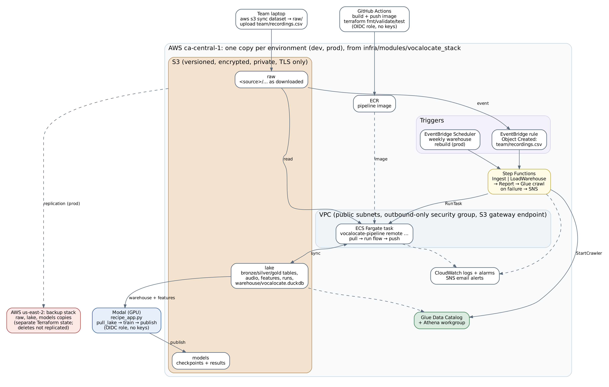

# VocaLocate infrastructure (Terraform)

The Part Three data pipeline, deployed to AWS as code. Two environments, `dev` and `prod`, are
built from the same module, so they differ only in size and safety settings. GPU training runs on
Modal, which reads from and writes to the same S3 buckets through an OIDC role.



The editor-facing parts of VocaLocate (the library pipeline and the search app) stay on the user's
computer, as promised in A1. AWS holds only the team's datasets, the processed lake and the models.

## Layout

```
infra/
  bootstrap/              once per account: Terraform state bucket, GitHub and Modal OIDC providers, budget
  backup/                 prod's backup buckets in us-east-2, in their own state (survives a prod teardown)
  envs/dev/, envs/prod/   one root per environment: backend, provider, sizes, safety settings
  modules/
    vocalocate_stack/     everything one environment needs; both envs call only this
    bucket/               a private, encrypted, TLS-only S3 bucket (used by every bucket here)
    network/              VPC, two public subnets, outbound-only security group, S3 gateway endpoint
    data_lake/            raw, lake and models buckets; replication to the backup stack
    pipeline_compute/     ECR repository, ECS cluster, Fargate task definition, task roles, logs
    orchestration/        Step Functions state machine, EventBridge upload trigger and schedules
    warehouse_catalog/    Glue Data Catalog + crawler over the lake tables, Athena workgroup
    monitoring/           SNS alert topic (email) and CloudWatch alarms on failed runs
    access/               OIDC roles for GitHub Actions (CI) and Modal (training); no stored keys
```

Every component is a Terraform module; there are no provisioning scripts. The only non-Terraform
steps are moving data (`aws s3 sync`), which is not infrastructure.

## What runs where

| Part 3 piece | AWS resource |
| --- | --- |
| Raw datasets and team recordings (bronze source files) | S3 `vocalocate-<env>-raw-<account>`, one folder per source |
| Lake: bronze/silver/gold tables, clean audio, features, `pipeline_runs` | S3 `vocalocate-<env>-lake-<account>`, same layout as the local `lake/` |
| DuckDB warehouse | `warehouse/vocalocate.duckdb` in the lake bucket, rebuilt by every run |
| SQL over the lake without downloading anything | Glue Data Catalog (`vocalocate_<env>_lake`) + Athena workgroup `vocalocate-<env>` |
| Ingest, clean, transform, load | ECS Fargate task running `vocalocate-pipeline remote …` (pipeline/Dockerfile) |
| "When the pipelines run" | Step Functions, started by an upload of `team/recordings.csv`, a schedule, or by hand |
| Data-quality alerts | `remote report` after every run; failures email the team (SNS) |
| GPU training (MobileNetV3 recipes) | Modal (`demo/modal/recipe_app.py`), results to S3 `vocalocate-<env>-models-<account>` |
| Model checkpoints and results | S3 models bucket |

### How a pipeline task uses S3

The flows from Part Three work on plain files (atomic renames, DuckDB, NumPy). Rather than rewrite
them for S3, each Fargate task works on a local copy of the lake
(`pipeline/src/vocalocate_pipeline/remote.py` and `sync.py`):

1. pull `s3://<raw>/<source>/` into `/lake/bronze/<source>/`;
2. pull the lake's tables and this source's clean audio and features, so the content-hash cache still
   skips clips that earlier runs finished;
3. run the normal dataset flow;
4. push back only what this source produced: its file in each table, its clean audio and features,
   and its run record. If the flow fails, only its `pipeline_runs` row is pushed.

The state machine then runs `remote load-warehouse`, which pulls every table and rebuilds the DuckDB
warehouse. Because an ingest never uploads another source's tables, and the copy step never
replaces a file that is newer in S3, two runs of different sources can overlap without one
overwriting the other's results.

The same commands work against local folders, which is how the tests run them.

### Environments

| | dev | prod |
| --- | --- | --- |
| Fargate task | 1 vCPU, 4 GB, 30 GB disk | 4 vCPU, 16 GB, 100 GB disk |
| Pipeline config | `pipeline/configs/dev.toml` (1 worker) | `pipeline/configs/prod.toml` (4 workers, one per vCPU) |
| Buckets | destroyed with their data (`force_destroy`) | refuse to be destroyed while they hold data |
| Old object versions kept | 7 days | 30 days |
| Backup | none | every bucket replicated to `infra/backup` (us-east-2) |
| Schedules | none | warehouse rebuild + report every Monday 06:00 Toronto |
| Logs kept | 7 days | 90 days |
| Modal environment allowed to assume the training role | `dev` | `main` |

Audio, feature and split settings are identical in both configs (a test checks this), so features
from dev and prod are interchangeable.

## Deploying

You need the AWS CLI signed in to the team account, Terraform 1.10 or newer, and for training the
Modal CLI (`pip install modal && modal setup`).

The account must allow ca-central-1 (prod and dev) and us-east-2 (backup). Our account was made
with AWS's new sign-up, which limits it to one region: we activated advanced features and added
`ca-central-1` to the `RegionFloor` list of the organization's
`AdvancedModeRegionRestrictionSecurityControlPolicy` (AWS Organizations, management account).

```bash
# 1. Once per account: state bucket, OIDC providers, budget.
cd infra/bootstrap
terraform init && terraform apply -var 'budget_emails=["team@example.com"]'
STATE=$(terraform output -raw state_bucket)

# 2. Backup buckets (prod replicates to them, so they come first).
cd ../backup
terraform init -backend-config="bucket=$STATE" && terraform apply

# 3. An environment. Copy terraform.tfvars.example to terraform.tfvars and fill it in first.
#    Tasks run the image of one commit; pass the commit you are deploying.
cd ../envs/dev
SHA=$(git rev-parse HEAD)
terraform init -backend-config="bucket=$STATE"
terraform apply -var image_tag=$SHA

# 4. The pipeline image for that commit: run the pipeline-image workflow on it (Actions tab,
#    environment dev). It needs the GitHub environment `dev` with variables AWS_ROLE_ARN
#    (terraform output github_role_arn) and ECR_REPOSITORY (terraform output ecr_repository_url).
#    The repository's tags are immutable, so `$SHA` always means that commit's code.

# 5. Modal: let the training app reach this environment's buckets.
terraform output -raw modal_secret_command | sh
```

Repeat steps 3 to 5 with `envs/prod` (Modal secret `vocalocate-aws-prod`, Modal environment `main`).
For dev training, create the Modal environment once with `modal environment create dev` and run
`VOCALOCATE_MODAL_AWS_SECRET=vocalocate-aws-dev modal run -e dev demo/modal/recipe_app.py`.

## Running the pipeline

```bash
RAW=$(terraform -chdir=infra/envs/dev output -json bucket_names | jq -r .raw)
SFN=$(terraform -chdir=infra/envs/dev output -raw state_machine_arn)

aws s3 sync ESC-50/ "s3://$RAW/esc50/"                                   # a dataset, as downloaded
aws stepfunctions start-execution --state-machine-arn "$SFN" --input '{"source":"esc50"}'
aws stepfunctions start-execution --state-machine-arn "$SFN" --input '{}' # rebuild warehouse + report

aws s3 cp recordings.csv "s3://$RAW/team/recordings.csv"                  # starts a team ingest by itself
```

Query the lake from the Athena console (workgroup `vocalocate-dev`, database `vocalocate_dev_lake`),
or download the warehouse and use DuckDB as before:

```bash
aws s3 cp "s3://$(terraform -chdir=infra/envs/dev output -json bucket_names | jq -r .lake)/warehouse/vocalocate.duckdb" .
vocalocate-pipeline --lake . report
```

## Checks

```bash
terraform fmt -check -recursive infra
cd infra/modules/vocalocate_stack && terraform init && terraform test   # offline, mocked AWS provider
```

`.github/workflows/infra.yml` runs both, plus `terraform validate` on every root, for any change
under `infra/`. On `main`, or when started by hand, it also runs `terraform plan` against the real
dev environment with the CI role, which needs the dev GitHub environment variables
`TF_STATE_BUCKET` and `MODAL_WORKSPACE_ID` as well as `AWS_ROLE_ARN`. `terraform apply` is never
run by CI: the CI role is read-only apart from pushing images, so infrastructure changes go through
a teammate's reviewed `terraform plan` and `apply`.

## Disaster recovery (Part Five)

Prod's data survives a full teardown because it is replicated to the backup stack, which has its
own state and does not replicate deletes. Outline of the demo:

```bash
cd infra/envs/prod
SHA=<commit deployed to prod>
terraform apply -var image_tag=$SHA -var force_destroy=true
terraform destroy -var image_tag=$SHA -var force_destroy=true                          # disaster
terraform apply -var image_tag=$SHA                                                     # rebuild
# The ECR repository was destroyed too: run the pipeline-image workflow for prod on $SHA.
aws s3 sync s3://vocalocate-backup-raw-<account>    s3://vocalocate-prod-raw-<account>
aws s3 sync s3://vocalocate-backup-lake-<account>   s3://vocalocate-prod-lake-<account>
aws s3 sync s3://vocalocate-backup-models-<account> s3://vocalocate-prod-models-<account>
aws stepfunctions start-execution --state-machine-arn "$(terraform output -raw state_machine_arn)" --input '{}'
```

The last step rebuilds the warehouse from the restored lake, runs the data-quality report and
re-crawls the catalog, which verifies the environment end to end.
